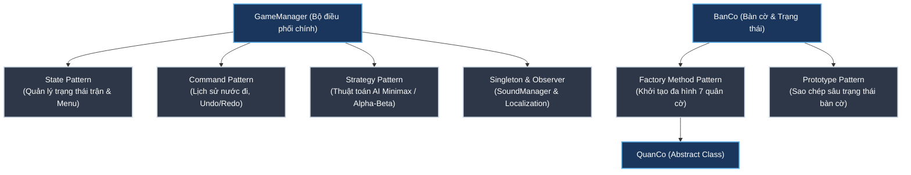

# 🎴 CỜ TƯỚNG (CHINESE CHESS) - OOP C++ & SFML

<div align="center">


**Đồ án môn Phương Pháp Lập Trình Hướng Đối Tượng (OOP)**  
*Trường Đại học Khoa học Tự nhiên – Đại học Quốc gia TP.HCM (HCMUS 2026)*

</div>

---

## 📖 Mục lục

- [Giới thiệu](#-giới-thiệu)
- [Tính năng nổi bật](#-tính-năng-nổi-bật)
- [Kiến trúc OOP & Design Patterns](#-kiến-trúc-oop--design-patterns)
- [Cấu trúc thư mục](#-cấu-trúc-thư-mục)
- [Yêu cầu hệ thống & Thư viện](#-yêu-cầu-hệ-thống--thư-viện)
- [Hướng dẫn cài đặt & Biên dịch](#-hướng-dẫn-cài-đặt--biên-dịch)
- [Cách chơi & Phím tắt điều khiển](#-cách-chơi--phím-tắt-điều-khiển)
- [Tác giả & Bản quyền](#-tác-giả--bản-quyền)

---

## 🌟 Giới thiệu

**Cờ Tướng (Chinese Chess)** là dự án phần mềm trò chơi cờ tướng hoàn chỉnh được phát triển bằng ngôn ngữ **C++17** kết hợp thư viện đồ họa **SFML 2.6.2**. Dự án được xây dựng với mục tiêu chuẩn hóa 100% luật thi đấu cờ tướng truyền thống Á Đông, tích hợp trí tuệ nhân tạo (AI) thông minh, đồng thời ứng dụng sâu rộng các mẫu thiết kế hướng đối tượng (**Design Patterns**) và nguyên lý kiến trúc phần mềm sạch.

---

## 🎨 Tính năng nổi bật

### 1. Giao diện Cuốn Sách Cổ (Ancient Travel Book UI)
- **Menu trang sách hoạt họa**: Hiệu ứng mở/đóng cuốn sách mượt mà, phân trang trực quan với đầy đủ các mục: *Chọn chế độ chơi*, *Nạp ván cờ*, *Cài đặt hệ thống*, *Thông tin kiến trúc*, *Xác nhận thoát*.
- **Typography Hán – Nôm Việt hóa cao cấp**: Tích hợp các bộ phông chữ mang đậm nét thư pháp cổ điển Á Đông (**Viaoda Libre**, **Nôm Na Tống**) kết hợp **Pixeloid Sans**, hiển thị nét dày dặn (**Bold**), tương phản cao, chống vỡ hạt trên màn hình độ phân giải cao (1920x1080).
- **Hệ thống Badge & Điểm nhấn hoàng kim**: Các chỉ số âm lượng, trạng thái BẬT/TẮT được thiết kế nguyên khối sang trọng trên nền giấy ấm viền hổ phách, hiệu ứng 4 góc vàng kim khi di chuột hoặc điều hướng bàn phím.
- **Tùy biến Quân cờ & Bàn cờ**: Tùy chọn kiểu quân Gỗ thực tế (*Realistic Wood*), Chữ Hán truyền thống (*Traditional Hanzi*), Ký hiệu chữ cái (*Modern Alphabet*), hiệu ứng Hào quang vương giả (*King Aura*) và rơi lá trúc (*Bamboo Atmosphere*).

### 2. Chuẩn hóa 100% Luật Di Chuyển Cờ Tướng
- **Tướng (General)**: Di chuyển 1 ô ngang/dọc trong Cung 3x3; kiểm tra nghiêm ngặt quy tắc chống mặt Tướng (*Flying Generals*).
- **Sĩ (Advisor)**: Di chuyển chéo 1 ô trong Cung bảo vệ Tướng.
- **Tượng (Elephant)**: Di chuyển chéo 2 ô, không được qua sông, cản mắt Tượng.
- **Xe (Chariot)**: Di chuyển ngang/dọc tự do khắp bàn cờ khi không có quân cản.
- **Pháo (Cannon)**: Di chuyển như Xe; khi bắt quân bắt buộc phải nhảy qua đúng 1 quân làm ngòi.
- **Mã (Horse)**: Di chuyển hình chữ Nhật (1 ô thẳng + 1 ô chéo), tuân thủ luật cản chân Mã.
- **Tốt (Soldier)**: Trước khi qua sông chỉ tiến thẳng 1 ô; sau khi qua sông có thể đi ngang hoặc tiến thẳng 1 ô (không được đi lùi).
- **Tự động phát hiện ván cờ**: Nhận diện tức thời Chiếu tướng (*Check*), Chiếu bí (*Checkmate*), Bí nước (*Stalemate*), Hết giờ thi đấu (*Time Out*).

### 3. Chế độ chơi đa dạng
- ⚔️ **Đấu hai người (PvP)**: Hai kỳ thủ so tài trực tiếp trên cùng máy tính, hỗ trợ nhập tên và chọn Avatar đại diện.
- 🤖 **Đấu với máy (PvAI)**: Thử sức với AI tích hợp thuật toán **Minimax** và **Tỉa nhánh Alpha-Beta** cùng Bảng điểm vị trí (*Piece-Square Tables*), phân cấp 3 mức độ: **Dễ**, **Trung bình**, **Khó**. Kỳ thủ có thể tùy chọn cầm quân Đỏ (đi trước) hoặc quân Đen (đi sau).
- 🎬 **Xem máy đánh (Demo Mode)**: Mô phỏng tự động ván cờ tàn mẫu kinh điển (2 Xe 2 Voi), minh họa các nước đi chiến thuật đối kháng đỉnh cao.

### 4. Tiện ích & Cơ chế trong ván đấu
- **Đồng hồ thi đấu (Chess Clock)**: Thiết lập linh hoạt (Vô hạn, 5 phút, 10 phút, 15 phút), tự động chuyển đổi lượt và đếm ngược chính xác.
- **Lịch sử nước đi (Move History)**: Bảng ghi nhận chi tiết từng nước đi, phân biệt màu sắc rõ nét giữa Đỏ và Đen.
- **Hoàn tác & Đi tiếp (Undo / Redo)**: Khôi phục lại trạng thái bàn cờ tức thì bằng phím tắt `Ctrl + Z`.
- **Lưu & Tải ván cờ (Save & Load Slots)**: 3 ô lưu độc lập giúp lưu trữ trạng thái trận đấu bất kỳ lúc nào để tiếp tục trải nghiệm sau này.
- **Tạm dừng & Trợ giúp**: Tạm dừng trận đấu, xin hòa cờ, đầu hàng và xem lại luật chơi ngay trong ván.

### 5. Âm thanh & Đa ngôn ngữ
- **Âm thanh chân thực**: Hiệu ứng tiếng gõ quân cờ cạch trên mặt gỗ, tiếng ăn quân, chuông báo chiếu tướng, tiếng đàn tranh Guzheng cổ phong nền tĩnh lặng.
- **Đa ngôn ngữ (Localization)**: Chuyển đổi linh hoạt giữa **Tiếng Việt** và **English** theo thời gian thực mà không cần khởi động lại trò chơi.

---

## 🏛️ Kiến trúc OOP & Design Patterns

Dự án áp dụng chặt chẽ 4 nguyên lý lập trình hướng đối tượng cùng 6 mẫu thiết kế (**Design Patterns**) kinh điển:



### 1. Bốn trụ cột OOP cốt lõi
- **Encapsulation (Đóng gói)**: Dữ liệu tọa độ, trạng thái sống/chết, nước đi hợp lệ của quân cờ và bàn cờ được bảo vệ nghiêm ngặt qua các access modifier (`private`, `protected`) và truy xuất có kiểm soát qua getter/setter.
- **Inheritance (Kế thừa)**: 7 lớp quân cờ cụ thể (`Xe`, `Ma`, `Voi`, `Phao`, `Tuong`, `Si`, `Tot`) kế thừa từ lớp cơ sở trừu tượng `QuanCo`.
- **Abstraction (Trừu tượng)**: `QuanCo` đóng vai trò là một Interface thuần ảo (`virtual bool kiemTraNuocDi(...) = 0;`), che giấu sự phức tạp trong quy tắc di chuyển của từng loại quân.
- **Polymorphism (Đa hình)**: Bàn cờ quản lý danh sách quân thông qua `std::shared_ptr<QuanCo>`. Khi thực hiện kiểm tra nước đi, hàm ảo của từng quân cờ cụ thể được gọi tự động tại thời điểm chạy (runtime polymorphism).

### 2. Các mẫu thiết kế (Design Patterns) áp dụng
1. **State Pattern**: Phân chia trạng thái hệ thống rõ ràng: Màn hình Bìa sách, Menu chính, Thiết lập trận đấu, Đang chơi, Tạm dừng, Kết thúc trận đấu.
2. **Command Pattern**: Mỗi nước đi được đóng gói thành một đối tượng Command (`NuocDi`) lưu trữ vị trí đi, vị trí đến, quân bị ăn. Nhờ đó, thao tác **Undo** và **Redo** được thực thi một cách chính xác và an toàn.
3. **Strategy Pattern**: Thuật toán AI được đóng gói thành chiến lược độc lập (`ChessAI`), cho phép chuyển đổi linh hoạt độ sâu tìm kiếm và ma trận đánh giá điểm số tương ứng với các cấp độ Dễ / Vừa / Khó.
4. **Factory Method Pattern**: Lớp `QuanCoFactory` chịu trách nhiệm khởi tạo đa hình các loại quân cờ dựa trên mã loại quân và màu sắc mà không để lộ logic khởi tạo ra bên ngoài.
5. **Prototype Pattern**: Phương thức `clone()` thực hiện Deep Copy đối tượng bàn cờ, cho phép AI giả lập hàng ngàn nhánh nước đi trên cây tìm kiếm mà không làm ảnh hưởng đến ván cờ thực tế.
6. **Singleton & Observer Pattern**: `SoundManager` và `Localization` áp dụng Singleton để duy trì một phiên bản duy nhất trong suốt vòng đời ứng dụng; đồng thời thông báo cập nhật giao diện khi người dùng chuyển đổi ngôn ngữ hoặc cài đặt âm thanh.

---

## 📂 Cấu trúc thư mục

```
CoTuong/
├── assets/                     # Tài nguyên hình ảnh, hiệu ứng UI và phông chữ
│   ├── Complete_UI_Book_.../   # Bộ sprite Cuốn sách cổ TravelBook Lite
│   ├── font/                   # Bộ phông chữ: Viaoda Libre, Nôm Na Tống, Pixeloid Sans
│   └── background play.jpg     # Hình nền ván cờ độ phân giải cao
├── include/                    # Header files (.h)
│   ├── Atmosphere.h            # Hiệu ứng khí quyển rơi lá trúc
│   ├── BanCo.h                 # Quản lý ma trận bàn cờ, nước đi, luật kiểm tra
│   ├── ChessAI.h               # Thuật toán AI Minimax & Alpha-Beta
│   ├── GameManager.h           # Bộ điều phối toàn bộ trò chơi, HUD và vòng lặp chính
│   ├── KeyConfig.h             # Cấu hình bộ phím điều khiển
│   ├── Localization.h          # Hệ thống đa ngôn ngữ (Tiếng Việt & English)
│   ├── Menu.h                  # Quản lý giao diện Menu Cuốn sách cổ và các nút bấm
│   ├── QuanCo.h                # Lớp cơ sở trừu tượng cho quân cờ
│   ├── QuanCoFactory.h         # Factory Method pattern khởi tạo quân cờ
│   ├── Slider.h                # Thanh trượt điều chỉnh âm lượng
│   ├── SoundManager.h          # Bộ quản lý âm thanh và nhạc nền
│   ├── TextInput.h             # Hộp nhập văn bản tên kỳ thủ
│   └── [Xe, Ma, Voi, ...].h    # 7 lớp quân cờ cụ thể
├── src/                        # File mã nguồn triển khai (.cpp)
│   ├── BanCo.cpp
│   ├── ChessAI.cpp
│   ├── GameManager.cpp
│   ├── Localization.cpp
│   ├── Menu.cpp
│   ├── SoundManager.cpp
│   ├── TextInput.cpp
│   └── [QuanCo, Xe, ...].cpp
├── resources/                  # Bản sao tài nguyên dự phòng (fonts, sounds)
├── SFML/                       # Bộ thư viện SFML 2.6.2 (64-bit Windows)
├── ChayGame.bat                # Script chạy game nhanh 1-click cho Windows
├── CMakeLists.txt              # Cấu hình biên dịch CMake đa nền tảng
├── CoTuong.exe                 # File thực thi đã biên dịch sẵn (Release x64)
├── main.cpp                    # Điểm khởi đầu chương trình (Entry point)
└── README.md                   # Tài liệu hướng dẫn dự án
```

---

## 💻 Yêu cầu hệ thống & Thư viện

- **Hệ điều hành**: Windows 10/11 64-bit (hỗ trợ Linux / macOS khi biên dịch bằng CMake).
- **Trình biên dịch**: MSVC (Visual Studio 2022 v143), GCC 10+, hoặc Clang 12+ hỗ trợ chuẩn **C++17**.
- **Thư viện đồ họa**: **SFML 2.6.2** (Graphics, Window, System, Audio). *Thư viện đã được đính kèm sẵn trong thư mục `SFML/` của project.*
- **Công cụ xây dựng**: **CMake 3.15** trở lên.

---

## 🚀 Hướng dẫn cài đặt & Biên dịch

### Cách 1: Chạy ngay không cần biên dịch (Khuyên dùng)
Trò chơi đã được biên dịch sẵn bản Release x64 tối ưu hóa hiệu năng cao nhất.
- Bạn chỉ cần nhấp đúp vào file **`ChayGame.bat`** (hoặc chạy trực tiếp **`CoTuong.exe`**) tại thư mục gốc của dự án để trải nghiệm game ngay lập tức.

---

### Cách 2: Tự biên dịch từ mã nguồn

#### Sử dụng Visual Studio 2022 (GUI)
1. Mở Visual Studio 2022, chọn **Open a local folder** và trỏ đến thư mục `CoTuong`.
2. Visual Studio sẽ tự động nhận diện `CMakeLists.txt` và nạp cấu hình.
3. Chọn cấu hình **`x64-Release`**, chọn mục khởi động là **`CoTuong.exe`**.
4. Nhấn **F5** hoặc nút **Build** để biên dịch và chạy trò chơi.

#### Sử dụng dòng lệnh (CMake CLI)
Mở PowerShell hoặc Command Prompt tại thư mục dự án và thực thi:

```powershell
# 1. Tạo thư mục build
mkdir build-vs
cd build-vs

# 2. Tạo project Visual Studio bằng CMake
cmake -G "Visual Studio 17 2022" -A x64 ..

# 3. Biên dịch bản Release
cmake --build . --config Release

# 4. Chạy game
cd Release
.\CoTuong.exe
```

---

## 🎮 Cách chơi & Phím tắt điều khiển

### 1. Thao tác điều khiển trên Bàn cờ
| Thao tác | Chuột | Bàn phím |
| :--- | :--- | :--- |
| **Di chuyển con trỏ** | Di chuột trực tiếp lên ô cờ | `W` / `A` / `S` / `D` hoặc các phím `Mũi tên` |
| **Chọn / Hạ quân cờ** | Nhấp chuột trái vào quân cờ / ô đi | Phím `Space` hoặc `Enter` |
| **Hủy chọn quân cờ** | Nhấp chuột phải | Phím `ESC` hoặc `Backspace` |
| **Hoàn tác nước đi (Undo)** | Nhấp nút **Undo** trên giao diện | Tổ hợp phím `Ctrl + Z` |
| **Mở Menu trận đấu** | Nhấp nút **Menu** trên màn hình | Phím `ESC` |

### 2. Thao tác trong Menu Cuốn Sách Cổ
- **Di chuyển mục chọn**: Phím `W` / `S` (Lên / Xuống).
- **Chuyển đổi thẻ chức năng**: Phím `A` / `D` (Trang Trái / Trang Phải).
- **Xác nhận / Nhấp chọn**: Phím `Enter` hoặc `Space`.
- **Quay lại màn hình trước**: Phím `ESC` hoặc nhấp vào góc đánh dấu sách.

---

## 👥 Tác giả & Bản quyền

- **Môn học**: Phương Pháp Lập Trình Hướng Đối Tượng 2 (OOP)
- **Đơn vị đào tạo**: Khoa Công nghệ Thông tin – Trường Đại học Khoa học Tự nhiên, ĐHQG-HCM (HCMUS).
- **Giấy phép**: Phát hành theo giấy phép **MIT License**. Tự do sử dụng, chỉnh sửa và phân phối cho mục đích học tập và nghiên cứu phi thương mại.
